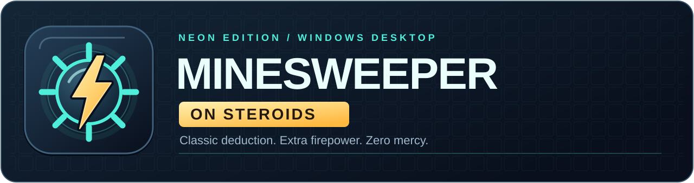
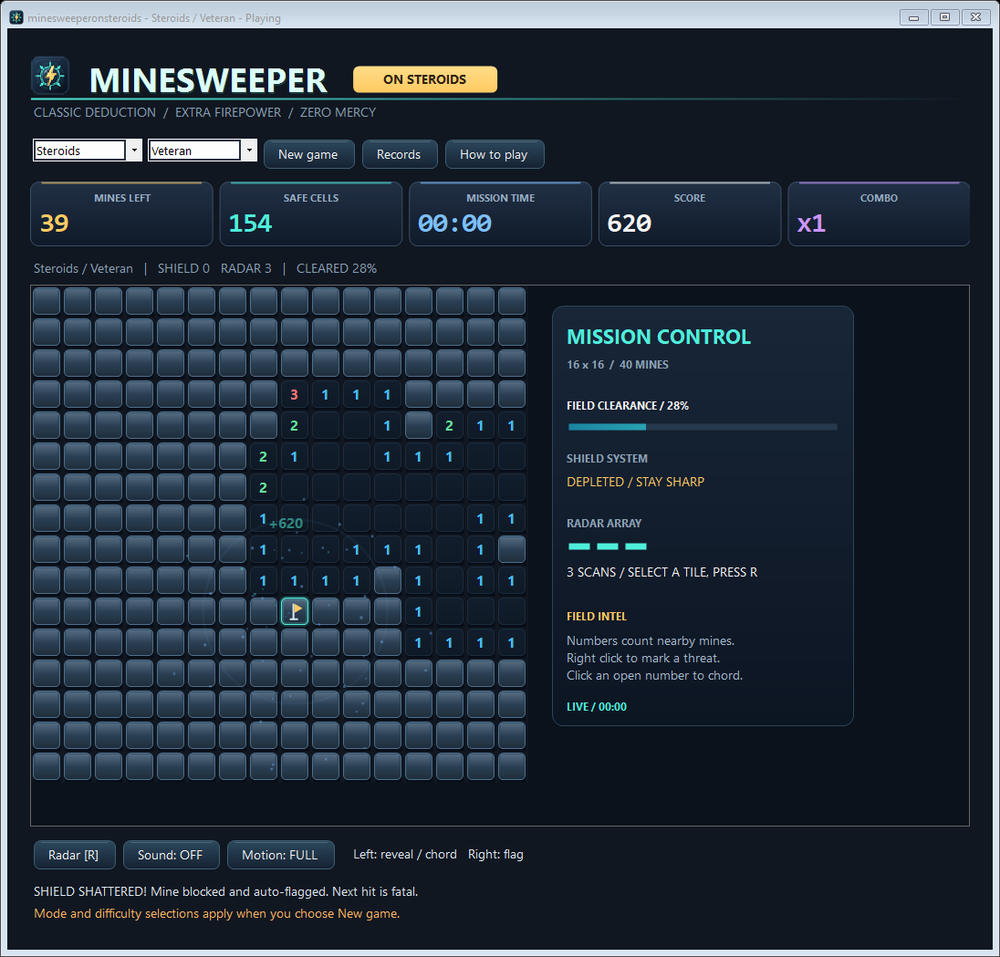
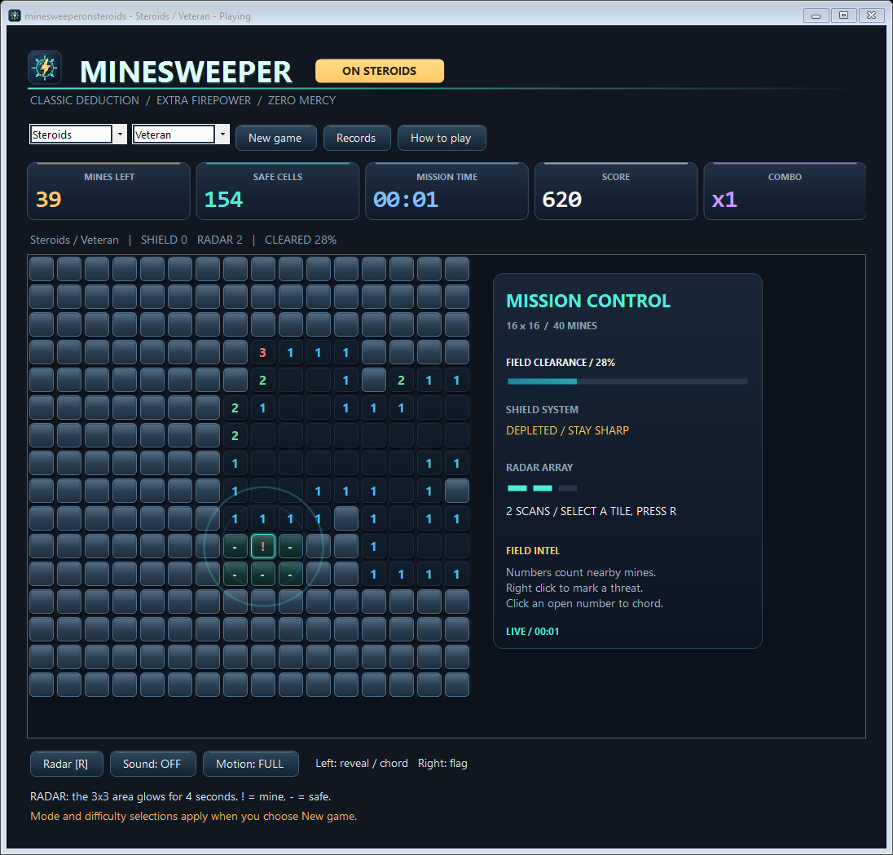
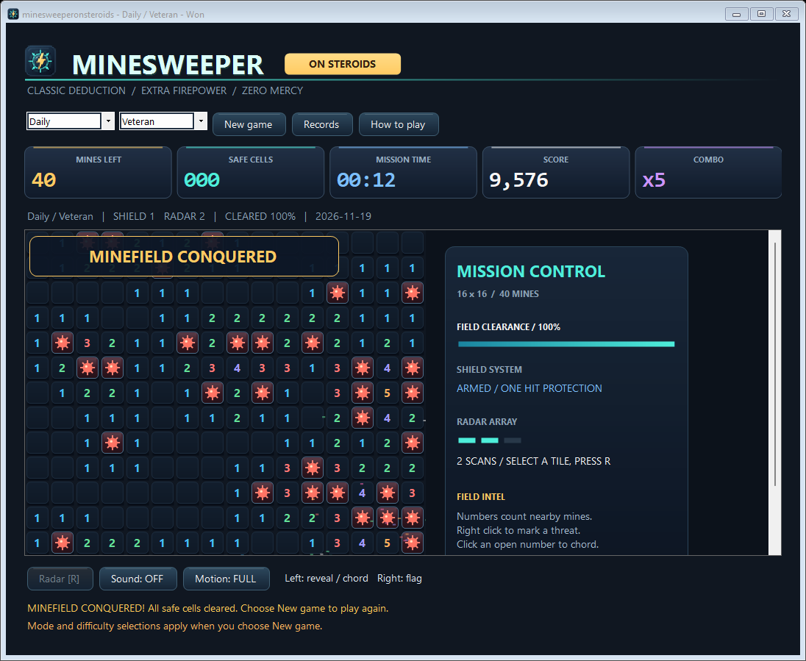
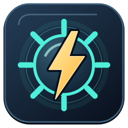

<p align="center">
  
</p>

# Minesweeper on Steroids

### Your first click is safe. Your ego is not.

Remember carefully clicking little squares on Windows? We gave those squares
neon armor, radar, a shield, a combo counter, and some very strong opinions
about your survival.

**A real Windows desktop game. No console window. No browser. No sign-in.
No internet required. Just one more round.**

---

## Less spreadsheet. More minefield.



*Actual gameplay from the native app. The blue burst is your shield doing its
one and only job. Please thank it before immediately hitting another mine.*

| Scan before you panic | Victory tastes like confetti |
| :---: | :---: |
|  |  |
| Three charges. Four seconds of forbidden knowledge. | Clear every safe cell. Collect points. Become insufferable. |

## What's on the steroids menu?

- **A glow-up, literally.** Glossy beveled tiles, neon highlights, gold flags,
  a five-card HUD, and a live Mission Control panel when the window has room.
- **Every click gets a little drama.** Reveal waves, flag pops, floating score
  rewards, radar pulses, shield bursts, detonation shockwaves, and victory confetti.
- **A tiny original arcade soundtrack for your decisions.** Nine synthesized
  effects for deployment, reveals, flags, radar, combos, shields, explosions,
  and victory. Effects only; no background music.
- **Up to 5x combos.** Chain productive reveals within four seconds.
  Confidence pays. Recklessness also pays, but usually in explosions.
- **Comfort controls.** Mute all audio with **Sound: OFF** or calm things down
  with **Motion: LOW**. Both choices are saved. Muting never hides visual clues.
- **Old-school rules underneath.** Mines stay put. Numbers tell the truth.
  Your flags, unfortunately, come with no such guarantee.

## Quick deploy

### Got the published build?

Double-click `publish\neon\minesweeperonsteroids.exe`.

The standalone **Windows x64** build includes .NET. Players do **not** need to
install a runtime. Published builds are local outputs under `publish\neon` and
are excluded from Git.

### Starting from source?

Install the **.NET 10 SDK** on Windows, open PowerShell in this folder, and run:

```powershell
dotnet run --project .\MinesweeperOnSteroids.csproj
```

Choose a mode and difficulty, then hit **New game**. Selectors configure the
*next* round, so they will not quietly mutate the one you are already playing.
Resize the window freely; large minefields scroll when needed.

## Pick your chaos

| Mode | Your equipment | The vibe |
| --- | --- | --- |
| **Classic** | No shield. No radar. No combo multiplier. | Just you, logic, and suspicious little numbers. |
| **Steroids** | One shield, three scans, up to 5x combos. | The familiar game, now with emergency services. |
| **Daily** | Steroids equipment; a date-seeded board and fixed center opening. | Same local date + difficulty = same problem to conquer. |

Daily is an offline, replayable challenge, not an anti-cheat leaderboard.
You can retry it as often as your pride requires.

| Difficulty | Field | Mines | Recommended attitude |
| --- | --- | --- | --- |
| **Rookie** | 9 x 9 | 10 | "I've got this." |
| **Veteran** | 16 x 16 | 40 | "Let me think." |
| **Maniac** | 30 x 16 | 99 | "That flag was definitely correct." |

## Hands on the controls

| Mouse / keyboard | What happens |
| --- | --- |
| **Left click** | Reveal a covered tile; chord an open number |
| **Right click** / **Shift+left click** | Place or remove a flag; also selects the tile |
| **Middle click** | Chord |
| **Radar button** / **R** | Scan a 3x3 area around the selected tile |
| **Arrows / WASD** | Move the cyan selection outline |
| **Space / F / Enter** | Reveal / flag / chord |
| **F2** | New game |
| **F1** | Field manual |
| **Tab** | Move between controls |

Movement and action keys work while the minefield has focus. Click the board
or Tab into it first. To aim radar **without** placing a flag, use the arrows.

Starting over or exiting asks for confirmation during an active round.
Help, records, and confirmation dialogs pause the timer and animations.
Opening a dialog also stops any playing sound.

## Rules of engagement

1. **Reveal every safe tile to win.** You do not need to flag every mine.
2. **Your first reveal and its neighbors are mine-free.** Empty areas flood open.
3. **A number counts mines in the eight surrounding tiles.** The clues are honest.
4. **Flag the threats, then chord the number.** If the adjacent flag count matches,
   chording opens the unflagged neighbors. A wrong flag can make that very fatal.
5. **The shield saves you once.** It blocks a mine and auto-flags it; it does
   **not** remove or move the mine. A multi-mine chord can still kill you.
6. **Radar is intel, not a reveal.** For four seconds, `!` marks a mine and `-`
   marks a safe tile in a 3x3 area, temporarily overriding flag display.

Gold pennants are flags. Spiked red icons are mines. An `X` at game over means
your flag and reality had a disagreement. Flags are not capped, so your
remaining-mine estimate can go negative.

<details>
<summary><strong>Score nerds, this one's for you</strong></summary>

- Each safe tile earns **10 points x combo**.
- Productive reveal/chord actions within **four seconds** raise the combo,
  capped at **5x**. Classic stays at **1x**.
- Victory adds **1,000 points**, plus **two points for each whole second
  remaining under ten minutes**.
- The timer starts on your first reveal, or immediately in Daily.
- Only wins enter the hall of survivors. Assisted and Classic scores are labeled
  and are not equivalent.

Animations are cosmetic. Actions apply immediately, effects never move mines,
and you can keep playing while particles do their thing.

</details>

## Your victories stay on your PC

Preferences and the best **100 wins** live here:

```text
%LOCALAPPDATA%\minesweeperonsteroids\records.json
```

Existing scores remain compatible. The in-game Records screen shows your top
15 wins with mode, difficulty, date, and time.

Storage or audio-device problems appear in the warning area instead of failing
silently. Invalid or unreadable records are not overwritten; move the affected
file aside and restart if you want to enable saving again.

## Built with logic. Tested with deliberate bad decisions.

**C# / .NET 10 / Windows Forms. No third-party packages.**

```powershell
dotnet build .\MinesweeperOnSteroids.csproj -c Release
$exe = '.\bin\Release\net10.0-windows\minesweeperonsteroids.exe'
(Start-Process $exe -ArgumentList '--self-test', 'rules-tests.txt' -Wait -PassThru).ExitCode
(Start-Process $exe -ArgumentList '--ui-test', 'ui-test-results' -Wait -PassThru).ExitCode
Get-Content .\rules-tests.txt
Get-Content .\ui-test-results\desktop-tests.txt
```

GUI executables do not need a console, so these checks write reports to the
specified paths. **Exit code 0 = success.**

Rules/audio tests cover generation, clues, safe openings, floods, flags, chords,
shields, radar, combos, daily seeds, win/loss rules, persistence, sound-wave
headers/sample bounds, playback dispatch, and preference compatibility.

Desktop checks exercise the actual Windows form, mouse and keyboard handlers,
the branded window icon, buttons, confirmations, radar expiry, scrolling,
daily restarts, wins/losses, record saving, animation frame changes, and
pause/reset/reduced-motion behavior. They save gameplay previews and use isolated
temporary records, not your personal scores.

UI tests need an interactive Windows desktop and mostly run muted; the sound
toggle plays one short confirmation tone. The audio check accepts an explicit
device warning on machines without audio hardware. It cannot verify that your
physical speakers are plugged in. Neither can the mines.

## Build your own portable panic button

```powershell
dotnet publish .\MinesweeperOnSteroids.csproj -c Release -r win-x64 --self-contained true -p:PublishSingleFile=true -o .\publish\neon
Start-Process .\publish\neon\minesweeperonsteroids.exe
```

The first publish may download Microsoft's Windows Desktop runtime packs.
The result is a standalone Windows app with its logo and sounds included.
No separate asset folder is needed next to the executable.

## The brand kit



The original **charged-mine** emblem combines the game's two essential
ingredients: a very bad square and an unreasonable amount of energy.
The same emblem appears in the window, taskbar, and Windows executable.

[Vector wordmark](assets/logo.svg) / [PNG wordmark](assets/logo.png) /
[Vector emblem](assets/icon.svg) / [PNG emblem](assets/icon.png) /
[Windows icon](assets/game.ico)

<br clear="left">

---

**One more round. This time, definitely no guessing.**
